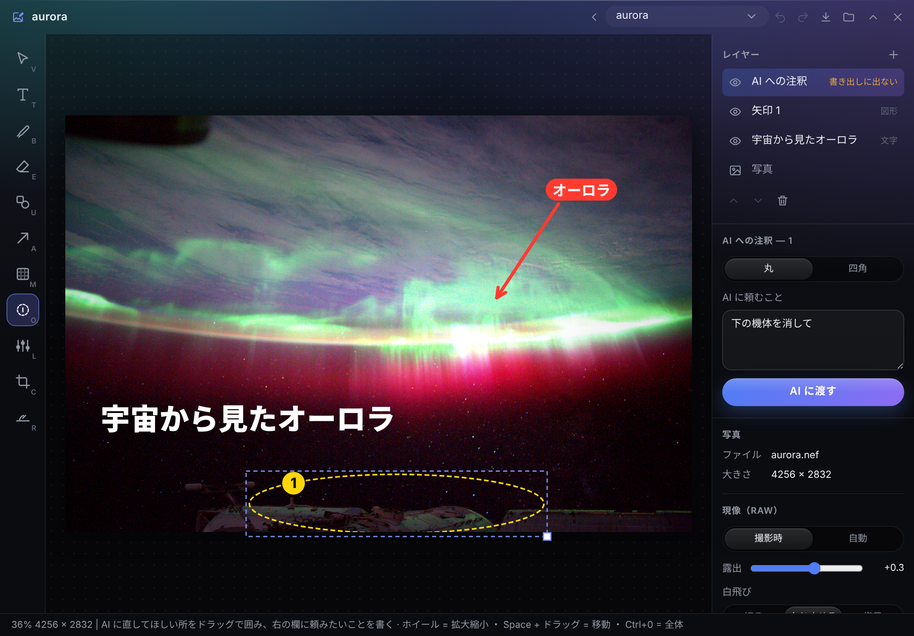
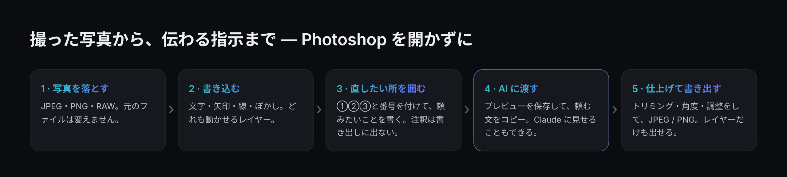
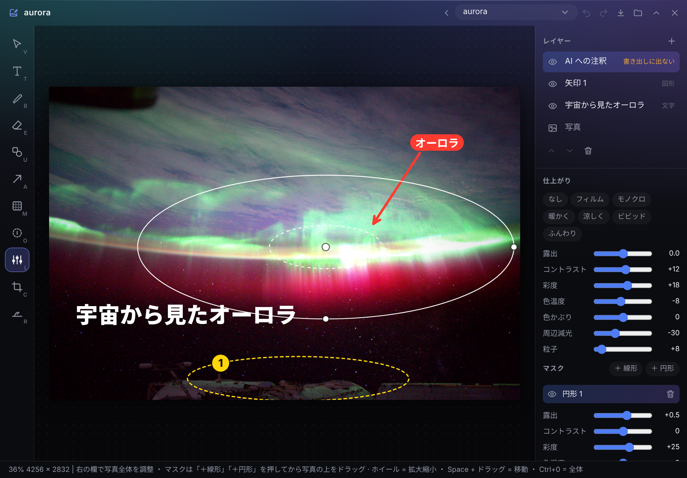

<p align="center"></p>

# フォトスケッチ（Photo Sketch）

<p align="center"><a href="README.md">English</a> · <b>日本語</b></p>

Windows のデスクトップの端に置く作業台 **[Hub](https://github.com/satosugarforwork44x-lang/desktop-hub)** の拡張アプリです。
写真に文字・矢印・線・ぼかしを入れ、**AI に直してほしい所を丸で囲んで**、画像と頼む文をまとめて ChatGPT・Gemini・**Claude** に渡せます。
Photoshop や Lightroom を開く必要はありません。元の写真には一切手を入れず、足したものはすべてレイヤーとして JSON で持ちます。



> ライセンス: [PolyForm Noncommercial 1.0.0](LICENSE)（個人・営利目的でない利用は自由）
> 見本の写真: NASA、ISS 第 30 次長期滞在（パブリックドメイン）

## 作った理由

写真の「編集」の多くは小さな作業です。SNS 用のひとこと、何かを指す矢印、ナンバープレートのぼかし、ちょっとしたトリミング。
そして最近は、本当の編集を AI に頼むことが増えました。「電線を消して」「空を明るくして」。

ところが、これが意外とやりにくいのです。

- **プロ用の道具は、小さな作業には重い。** 文字を 1 行入れるために Photoshop や Lightroom を開くと、作業より待ち時間のほうが長くなります
- **AI に「どこを」が伝わらない。** 「左のあれを消して」では曖昧です。写真に丸を描けば伝わりますが、その丸が送る画像に焼き込まれてしまいます
- **スマホのアプリは、基本的なことが有料。** 文字の装飾・周辺減光・モザイク・フィルム風。どれも簡単な加工なのに、課金の壁があります

そこでフォトスケッチは、**Hub の中にある軽い作業台**にしました。いつも画面の端にあり、1 クリックで開けます。

- **AI への注釈は、写真とは別。** 丸で囲んで ①②③ と番号を付け、頼みたいことを書きます。注釈が出るのはパネルと *AI 用プレビュー* だけで、書き出しには出ません
- **何でもレイヤー、何でもデータ。** 文字・矢印・線・ぼかし・マスク、すべて JSON です。Claude がファイルを読んで直すと、パネルが読み直します
- **元の写真はそのまま。** トリミング・角度・調整は「指示」として持ち、写真の画素は変えません。どれも `Ctrl+Z` で戻せます



## UX で決めたこと

| 決めたこと | 理由 |
|---|---|
| **AI への注釈は、書き出さないレイヤー** | 目的は、写真を壊さずに AI へ「どこか」を見せること。AI 用プレビュー（`_ai/<名前>.png`）には番号付きで描き、書き出しには一切出しません |
| **「AI に渡す」で 3 つをまとめて行う** | プレビューの保存、頼む文（「① 電線を消して …、それ以外は元のまま」）のコピー、エクスプローラーでファイルを開く。あとは ChatGPT・Gemini に 2 つ貼るだけ |
| **道具はすべてボタンにして、キーも表示** | 前の拡張（サウンドスケッチ）の反省です。キーでしか使えない機能は気づかれません。左の列のボタンに `V T B E U A M O L C R` を表示し、マウスでも同じことができます |
| **消しゴムは線を消し、写真は消さない** | 線はベクターで持っています。消した所の点を除いて線を分けるので、なぞった線がきれいなまま再利用できます（レイヤーだけを透過 PNG で書き出せる） |
| **大きさは画面ではなく写真に合わせる** | ペンの太さと文字の大きさは「写真の長辺に対する割合」で覚えます。1200 万画素のスマホ写真でも 6000 万画素の RAW でも、同じ見た目になります |
| **角度は写真だけを回す** | 地平線をまっすぐにしても、文字や矢印は水平のまま。黒い隅が出ないよう、トリミングの枠を自動で合わせます |
| **マスクは軽く: 線形と円形だけ** | Lightroom 風の部分補正を、ブラシなしで（ブラシは重くなる）。ドラッグ中は効く範囲を赤く見せます |
| **RAW はすぐ開き、あとで現像** | まず RAW の中の JPEG を出し、現像が終わったら差し替えます。現像の仕組みが無い環境でも、中の JPEG で開けます |
| **上書きしない** | 書き出しは `名前 (2).jpg`。編集はその場で保存し、Claude が入れた変更も含めて元に戻せます |

## できること

| 機能 | 内容 |
|---|---|
| **文字**（`T`） | PC に入っている書体（游ゴシック・游明朝・メイリオ・BIZ UD・UD デジタル教科書体・Noto Sans JP など）、大きさ、色、太字、縁取り、影、帯 |
| **ペン・消しゴム**（`B` / `E`） | 手描きの線。線ごとのレイヤー |
| **図形・矢印**（`U` / `A`） | 四角・丸・線・矢印。矢印には「ひとこと」を付けられる |
| **ぼかし・モザイク**（`M`） | 顔やナンバーを四角・丸で隠す。レイヤーなので、あとから動かせる |
| **AI への注釈**（`O`） | 番号付きの丸・四角と、それぞれの頼みごと。書き出しには出ない |
| **調整**（`L`） | 露出・コントラスト・彩度・色温度・色かぶり・周辺減光・粒子。プリセット: フィルム・モノクロ・暖かく・涼しく・ビビッド・ふんわり |
| **マスク**（`L`） | 線形（端から）と円形（中心から。ぼかし幅・反転）。マスクごとに調整を持つ |
| **トリミング・角度**（`C` / `R`） | 縦横比 自由・元の比・1:1・4:5・16:9・9:16。地平線に沿ってドラッグすると水平に |
| **RAW** | DNG・CR2・CR3・NEF・ARW・RAF・ORF・RW2・PEF・SRW。rawpy でホワイトバランス・露出・白飛びの回復 |
| **書き出し**（`Ctrl+E`） | JPEG（画質）か PNG。原寸・長辺 2048・1080。レイヤーだけを透過 PNG でも |
| **日本語と英語** | パネルはどちらの言語でも使えます |

## 使い始める

**Hub 0.8 以上**が必要です（画像の受け渡しと、Claude が画像を見る機能のため）。必須の Python パッケージはありません。

1. このリポジトリを、Hub のモジュールのフォルダに **`photo` という名前で**置きます（フォルダ名はモジュールの id と同じにする）
   ```bat
   git clone https://github.com/satosugarforwork44x-lang/photo-sketch "%LOCALAPPDATA%\Hub\modules\photo"
   ```
2. （任意・RAW を本当に現像したいとき）Python 3.12〜3.14 で:
   ```bat
   py -m pip install --user -r "%LOCALAPPDATA%\Hub\modules\photo\requirements.txt"
   ```
3. Hub を再起動すると、バーに **フォトスケッチ** が出ます。写真をパネルに落としてください。
   編集データはフォルダ窓の置き場所の下の **`Photo Sketch`** フォルダにしまうので、そのままフォルダ窓にもなります
4. （任意）Claude に見せたり直してもらったりするとき: Hub の設定（⚙）→ Claude との連携 → `Photo Sketch` を **読み書き** にし、**画像も Claude に見せる** を ON

## キー

| キー | 道具 | キー | 操作 |
|---|---|---|---|
| `V` | 選択・移動 | `Ctrl+Z` / `Ctrl+Y` | 元に戻す / やり直す |
| `T` | 文字 | `Ctrl+S` | 保存（AI 用プレビューも更新） |
| `B` / `E` | ペン / 消しゴム | `Ctrl+E` | 書き出し |
| `U` / `A` | 図形 / 矢印 | `[` `]` | 細く・太く、小さく・大きく |
| `M` | ぼかし・モザイク | `Space` + ドラッグ | 表示を動かす |
| `O` | AI への注釈 | `Ctrl+0` / `Ctrl+1` | 全体 / 100% |
| `L` | 調整・マスク | `Delete` | 選んだ物を消す |
| `C` / `R` | トリミング / 角度 | 矢印キー | 1 画素ずつ動かす（Shift で 10） |

## AI と使う

**ChatGPT・Gemini（画像の編集）:** `O` で場所を囲み、それぞれに頼むことを書いて **AI に渡す** を押します。
コピーされた文と、開いたプレビューの画像をチャットに貼ってください。

**Claude（Hub の MCP をつないだ Claude Desktop）:** たとえば次のように頼めます。

- 「フォトスケッチの `aurora` を見て。どこをどう直すとよくなる？」
- 「左下に題名を入れて、オーロラの一番明るい所に矢印を付けて」
- 「上から線形のマスクで空を暗くして」

Claude は [`PHOTO_FORMAT.md`](PHOTO_FORMAT.md)（保存先に自動で置かれる）・`.photo.json`・AI 用プレビューを読み、JSON を書き換えます。
パネルは 1 秒ほどで変更を読み直し、`Ctrl+Z` で戻すこともできます。



## しくみ

| ファイル | 役割 |
|---|---|
| `manifest.json` | Hub のモジュールの定義（`moduleApi 1`、Hub 0.8 以上）。パネル・バーのアイコン・公開する関数・画像を渡す `/blob/photo/…`・描いた画像を受け取る `upload` |
| `api.py` | フォトスケッチを開く・確かめる（読めない所は警告を出して飛ばす）・壊れないように保存・AI 用プレビューと書き出し（上書きしない） |
| `raw.py` | RAW: 任意の追加の現像 → rawpy → RAW の中の JPEG（標準ライブラリだけで取り出す） |
| `ui/render.js` | 画面・AI 用プレビュー・書き出しを **1 つの関数で描く**。色の行列を掛けた写真 → マスク → 周辺減光・粒子 → レイヤー |
| `ui/panel.js` | パネル: 道具・レイヤー・調整・トリミング・書き出し・キー |
| `ui/geom.js` | 当たり判定・移動・大きさ変更・線の消しゴム |
| `PHOTO_FORMAT.md` | Claude 向けに書いた形式の説明 |

- **データが正。** `.photo.json` だけが正しい状態です。パネルは更新時刻を見ているので、Claude が直した内容はそのまま画面に出ます
- **軽さを優先。** 色の調整は 1 つの色の行列（SVG の `feColorMatrix`）を Canvas の filter で掛けるだけ。マスクは調整した写真をグラデーションで切り抜いて重ねます。画面は画面の大きさで計算し、書き出しだけ原寸で計算します
- **追加の RAW 現像（任意）。** `raw.py` の隣に `raw_local.py` があれば、それを最初に使います。作者は、Python 3.15 用の rawpy がまだ無いため、LibRaw の `dcraw_emu.exe` を呼ぶものを使っています。このリポジトリには含めていません

## 開発

```bat
py -m unittest discover -s tests -v
```

## ライセンス

**[PolyForm Noncommercial 1.0.0](LICENSE)** — **個人・学習・研究など営利目的でない利用**なら、使う・読む・改変する・共有するのは自由です。
商用利用はできません。商用で使いたい場合は作者に連絡してください。

| ライブラリ | 用途 | ライセンス | 必須 |
|---|---|---|---|
| rawpy（中に LibRaw） | RAW の現像 | MIT（LibRaw: LGPL-2.1 / CDDL-1.0） | 任意 |
| Pillow | 現像した RAW を JPEG で渡す（無ければ PNG） | MIT-CMU（HPND） | 任意 |

ロゴ（`assets/`）もこのリポジトリと同じライセンスです。`docs/` の見本の写真は NASA のもの（パブリックドメイン）です。
