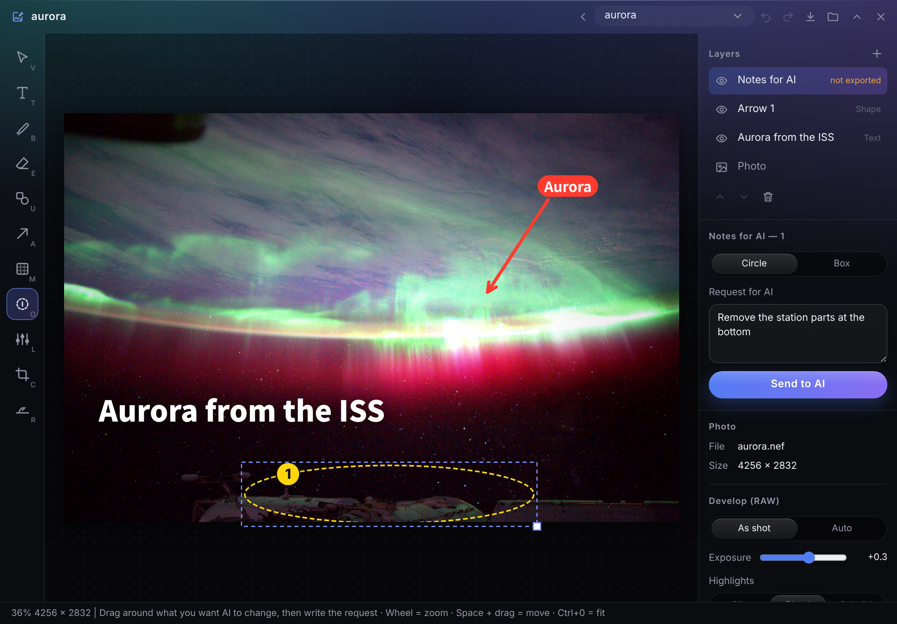
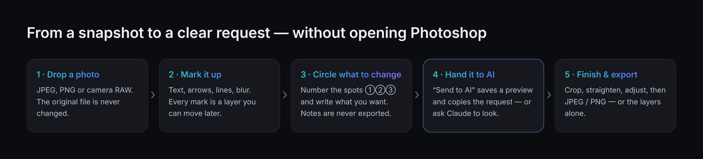
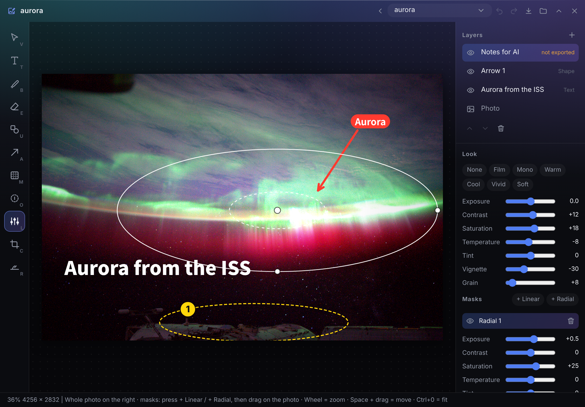

<p align="center"></p>

# Photo Sketch

<p align="center"><b>English</b> · <a href="README.ja.md">日本語</a></p>

An extension app for **[Hub](https://github.com/satosugarforwork44x-lang/desktop-hub)**, the slim bar on the edge of your Windows desktop.
Put text, arrows, lines and blur on a photo, **circle what you want an AI to change**, and hand both the picture and the request
to ChatGPT, Gemini or **Claude** — without opening Photoshop or Lightroom. The original photo is never touched: everything you add is a layer, kept as JSON.



> License: [PolyForm Noncommercial 1.0.0](LICENSE) — free for personal and other non-commercial use.
> Sample photo: NASA, ISS Expedition 30 (public domain).

## Why I built this

Most of my photo "edits" are small: a caption for social media, an arrow to point something out, a blurred licence plate,
a quick crop. And more and more often the real edit is done by an AI — "remove the wires", "make the sky brighter".

Doing that well was surprisingly clumsy:

- **Pro tools are heavy for small jobs.** Opening Photoshop or Lightroom to add one line of text takes longer than the edit.
- **Telling an AI *where* is hard.** "Remove the thing on the left" is vague. Drawing a circle on the photo works, but then the circle is burned into the image you send.
- **Phone apps hide the basics behind a paywall.** Text styles, vignette, mosaic, film looks — simple things that should be free.

So Photo Sketch is a **light editing table that sits in Hub**, one click away:

- **Notes for AI are separate from the picture.** Circle a spot, number it ①②③ and write the request. Notes appear only in the panel and in an *AI preview*; they are never exported.
- **Everything is a layer, kept as data.** Text, arrows, lines, blur, masks — all JSON. Claude can read the file and change it, and the panel reloads.
- **The original stays untouched.** Crops, angles and adjustments are instructions, not pixels. Undo anything with `Ctrl+Z`.



## UX decisions

| Decision | Why |
|---|---|
| **AI notes are a layer that is never exported** | The whole point is to *show* an AI where, without ruining the picture. The AI preview (`_ai/<name>.png`) draws them with numbers; exports never do |
| **"Send to AI" does three things at once** | Saves the preview, copies a ready-made request ("① remove the wires …, keep everything else"), and opens the file in Explorer — so you paste two things into ChatGPT / Gemini and you're done |
| **Every tool is a visible button with its key** | A lesson from the previous Hub app: features that only exist as shortcuts are never found. The tool rail shows `V T B E U A M O L C R` on each button, and everything works with the mouse too |
| **The eraser erases lines, not the photo** | Strokes are vectors. Erasing removes points and splits the line, so traced lines stay clean and reusable (e.g. export the layers alone as a transparent PNG) |
| **Sizes follow the photo, not the screen** | Pen width and text size are stored as a share of the photo's long side, so they look the same on a 12 MP phone shot and a 60 MP RAW |
| **Straightening rotates only the photo** | Text and arrows stay level while the horizon is fixed; the crop shrinks automatically so no black corners appear |
| **Masks are light: linear and radial only** | Lightroom-style local adjustments without a brush (brushes get heavy). Masks show in red while you drag them |
| **RAW opens instantly, then develops** | The JPEG inside the RAW appears first; the developed image replaces it when ready. Without a RAW developer, you still get the embedded JPEG |
| **Nothing is overwritten** | Exports become `name (2).jpg`; edits are saved as you go and can be undone, including changes made by Claude |

## Features

| Feature | What it does |
|---|---|
| **Text** (`T`) | Fonts installed on your PC (Yu Gothic, Yu Mincho, Meiryo, BIZ UD, UD Digi Kyokasho, Noto Sans JP, …), size, colour, bold, outline, shadow, background band |
| **Pen / eraser** (`B` / `E`) | Freehand lines on their own layers |
| **Shapes / arrow** (`U` / `A`) | Box, circle, line, arrow. An arrow can carry a short comment in a pill |
| **Blur / mosaic** (`M`) | Hide faces or number plates with a box or circle. It's a layer, so you can move it later |
| **Notes for AI** (`O`) | Numbered circles or boxes with a request each. Never exported |
| **Adjust** (`L`) | Exposure, contrast, saturation, temperature, tint, vignette, grain. Presets: film, mono, warm, cool, vivid, soft |
| **Masks** (`L`) | Linear (from an edge) and radial (from a centre, with feather and invert), each with its own adjustments |
| **Crop / straighten** (`C` / `R`) | Aspect ratios free, original, 1:1, 4:5, 16:9, 9:16. Draw along the horizon to level it |
| **RAW** | DNG, CR2, CR3, NEF, ARW, RAF, ORF, RW2, PEF, SRW. White balance, exposure and highlight recovery with rawpy |
| **Export** (`Ctrl+E`) | JPEG (quality) or PNG, full size / 2048 / 1080, or the layers alone as a transparent PNG |
| **English & Japanese** | The panel is available in both languages |

## Getting started

Requires **Hub 0.8 or later** (for image upload and Claude image access). No Python packages are required.

1. Put this repository into Hub's module folder **as `photo`** (the folder name must match the module id):
   ```bat
   git clone https://github.com/satosugarforwork44x-lang/photo-sketch "%LOCALAPPDATA%\Hub\modules\photo"
   ```
2. (Optional, for real RAW developing) on Python 3.12–3.14:
   ```bat
   py -m pip install --user -r "%LOCALAPPDATA%\Hub\modules\photo\requirements.txt"
   ```
3. Restart Hub. **Photo Sketch** appears on the bar. Drop photos onto the panel.
   Your sketches are kept in a **`Photo Sketch`** folder next to your folder panels, so it also becomes a folder panel.
4. (Optional) To let Claude see and edit them: Hub Settings (⚙) → Claude integration → set `Photo Sketch` to **read & write** and turn on **Let Claude view images**.

## Keys

| Key | Tool | Key | Action |
|---|---|---|---|
| `V` | Select / move | `Ctrl+Z` / `Ctrl+Y` | Undo / redo |
| `T` | Text | `Ctrl+S` | Save (and refresh the AI preview) |
| `B` / `E` | Pen / eraser | `Ctrl+E` | Export |
| `U` / `A` | Shapes / arrow | `[` `]` | Thinner / thicker, smaller / larger |
| `M` | Blur / mosaic | `Space` + drag | Move the view |
| `O` | Note for AI | `Ctrl+0` / `Ctrl+1` | Fit / 100 % |
| `L` | Adjust & masks | `Delete` | Remove the selection |
| `C` / `R` | Crop / straighten | Arrow keys | Nudge 1 px (Shift: 10 px) |

## Working with AI

**ChatGPT / Gemini (image editing):** circle the spots with `O`, write a request for each, press **Send to AI**.
Paste the copied text and the preview image into the chat.

**Claude (Claude Desktop with Hub's MCP):** ask things like

- "Look at `aurora` in Photo Sketch. What would you change, and how?"
- "Add a title at the bottom left and an arrow to the brightest part of the aurora."
- "Darken the sky with a linear mask from the top."

Claude reads [`PHOTO_FORMAT.md`](PHOTO_FORMAT.md) (copied into your folder automatically), the `.photo.json` file and the AI preview,
then edits the JSON. The panel picks up the change within about a second, and you can undo it.

```jsonc
{
  "format": "hub-photo/1",
  "source": { "path": "D:/DCIM/aurora.nef", "w": 4284, "h": 2844, "raw": true },
  "adjust": { "exposure": 0, "contrast": 12, "saturation": 18, "temp": -8, "tint": 0, "vignette": -30, "grain": 8 },
  "masks":  [ { "type": "radial", "cx": 2500, "cy": 1450, "rx": 1700, "ry": 650, "feather": 0.7, "adjust": { "exposure": 0.5 } } ],
  "layers": [
    { "type": "text",  "text": "Aurora from the ISS", "x": 240, "y": 1960, "size": 200, "font": "Noto Sans JP" },
    { "type": "shape", "shape": "arrow", "x": 3350, "y": 600, "w": -420, "h": 640, "label": "Aurora" },
    { "type": "note",  "items": [ { "n": 1, "x": 1250, "y": 2440, "w": 2000, "h": 400, "memo": "Remove the station parts" } ] }
  ]
}
```



## How it works

| Piece | Role |
|---|---|
| `manifest.json` | Hub module definition (`moduleApi 1`, Hub ≥ 0.8): panel, tile icon, exported functions, `/blob/photo/…` for images, `upload` for rendered images |
| `api.py` | Opens and validates sketches (anything unreadable is skipped with a warning), atomic saves, AI preview and exports without overwriting |
| `raw.py` | RAW: an optional local developer → rawpy → the JPEG inside the RAW (pure Python, no dependencies) |
| `ui/render.js` | **One renderer** for the screen, the AI preview and exports: photo with a colour matrix, masks, vignette and grain, then layers |
| `ui/panel.js` | The panel: tools, layers, adjustments, crop, export dialog, key handling |
| `ui/geom.js` | Hit-testing, moving, resizing, vector erasing |
| `PHOTO_FORMAT.md` | The format, written for Claude |

- **Data first.** The `.photo.json` file is the single source of truth. The panel polls its modification time, so edits from Claude just appear.
- **Light by design.** Colour adjustments are a single colour matrix (SVG `feColorMatrix`) applied as a Canvas filter; masks re-draw the adjusted photo through a gradient. The screen is computed at screen resolution, exports at full resolution.
- **Local RAW developer (optional).** If a file `raw_local.py` exists next to `raw.py`, it is tried first. The author uses one that calls LibRaw's `dcraw_emu.exe`, because rawpy is not yet available for Python 3.15. It is not part of this repository.

## Development

```bat
py -m unittest discover -s tests -v
```

## License

**[PolyForm Noncommercial 1.0.0](LICENSE)** — free to use, read, modify and share for **personal, study, research and other non-commercial purposes**.
Commercial use is not permitted. For commercial use, please contact the author.

| Library | Used for | License | Required |
|---|---|---|---|
| rawpy (LibRaw inside) | RAW developing | MIT (LibRaw: LGPL-2.1 / CDDL-1.0) | optional |
| Pillow | JPEG for developed RAW (PNG otherwise) | MIT-CMU (HPND) | optional |

The logo (`assets/`) is covered by the same license as this repository. The sample photo in `docs/` is by NASA (public domain).
